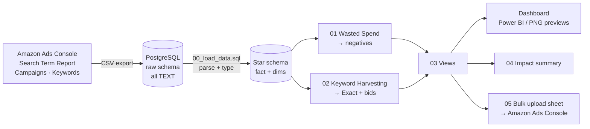

# 🌿 Amazon PPC Search Term Optimization: Cutting Wasted Ad Spend & Scaling ROAS

### *A reproducible SQL + Power BI pipeline that turns raw Amazon Sponsored Products Search Term Reports into negative keyword lists, harvest lists, and data-driven bids for a natural skincare brand*


> **Headline result (90-day synthetic dataset):** The pipeline flags **$12,900 (23.5%) of ad spend** going to non-converting or unprofitable search terms, and finds **70 converting search terms** that weren't yet targeted as Exact. Cutting the waste and reinvesting 40% of it into the harvested keywords brings projected **ACoS from 37.7% to 30.0%** and **ROAS from 2.65 to 3.33**, with **14% less ad spend** and **8% more attributed sales**.

> ⚠️ **Data disclaimer:** *TerraBloom Botanicals* is a fictional brand, and all performance data is **synthetic**. `scripts/generate_synthetic_data.py` generates it to match the column layout of a real Amazon Ads *Search Term Report*, with realistic intent-driven behaviour (ambiguous ingredient keywords, long-tail distribution, Poisson clicks, binomial conversions, 7-day attribution). Every number in this README comes from running the SQL in this repo against that data (`outputs/impact_summary.txt`). The same pipeline runs on a real Amazon export.

---

## 📑 Table of Contents

1. [Executive Summary](#1-executive-summary)
2. [Business Problems](#2-business-problems)
3. [Tech Stack](#3-tech-stack)
4. [Data Model & Architecture](#4-data-model--architecture)
5. [Keyword Universe: Product & Keyword Set](#5-keyword-universe-product--keyword-set)
6. [Core SQL Queries & Business Logic](#6-core-sql-queries--business-logic)
7. [Dashboard](#7-dashboard)
8. [Key Insights & Strategic Recommendations](#8-key-insights--strategic-recommendations)
9. [How to Reproduce](#9-how-to-reproduce)
10. [Limitations & Next Steps](#10-limitations--next-steps)

---

## 1. Executive Summary

### Business Context

**TerraBloom Botanicals** is a fictional Amazon FBA brand selling a **Turmeric & Aloe Vera Gentle Foaming Face Cleanser** with these product claims:

| Attribute | Detail |
|---|---|
| Hero ingredients | Turmeric (*Curcuma longa*), Aloe Vera, Green Tea, Chamomile |
| Positioning | Vegan · Cruelty-free (not tested on animals) · Alcohol-free · Herbal / plant-based |
| Price | $24.99 single · $42.48 two-pack → **$27.82 average order value** |
| Unit economics | $24.99 − $6.25 COGS − $5.00 FBA − 15% referral = **40% margin before ads → break-even ACoS 40%** |
| Business goal | **Target ACoS = 30%**, to keep a profit buffer while ads support organic rank |

The brand runs a standard Sponsored Products structure: **Auto**, **Broad**, **Phrase**, **Exact**, **Brand Defense** and **Competitor ASIN** campaigns. After 90 days, sales were growing but **ACoS was 37.7%**, only 2.3 points below break-even. The team had no repeatable process for reviewing the **4,027 unique customer search terms** in the reports.

### What This Project Does

1. **Ingest:** Load the raw Amazon CSV exports into a PostgreSQL landing schema, exactly as Amazon formats them (`"Jul 01, 2026"`, `"$1,234.56"`, trailing spaces in headers).
2. **Transform:** Clean and type the data into a star schema, then compute ACoS, ROAS, CPC, CVR, CTR and RPC per search term, ad group, and campaign.
3. **Decide:** Rule-based classification (`CASE WHEN`) produces:
   - A **negative keyword list** (stop the waste)
   - A **harvest list** with suggested bids (scale the winners)
   - An **Amazon bulk upload sheet** with 428 ready-to-review rows
4. **Visualize:** A 3-page dashboard lets marketing managers act weekly without writing SQL.

### Baseline Performance (Jul 1 – Sep 28, 2026)

| Impressions | Clicks | Spend | Orders | Sales | CTR | CPC | CVR | ACoS | ROAS |
|---|---|---|---|---|---|---|---|---|---|
| 7.41M | 47,393 | $54,883 | 5,232 | $145,562 | 0.64% | $1.16 | 11.0% | **37.7%** | **2.65** |

---

## 2. Business Problems

| # | Problem | Symptom in the Data | Business Impact |
|---|---|---|---|
| **P1** | **Spend on search terms that never convert** | Auto/Broad match *"turmeric"* and *"aloe vera"* to supplement, haircare, raw-ingredient and serum queries | **$4,140** spent with **0 orders** across 190 ad-group rows |
| **P2** | **Unprofitable generic "bleeder" terms** | *"face wash for sensitive skin"*, *"gentle face wash"*, *"gel cleanser"* convert at only 6% vs 11% for the account | **$8,760** spent at **106% ACoS**: the brand loses money on every one of these sales |
| **P3** | **Keyword harvesting gaps** | Proven converters live only inside Auto/Broad/Phrase, with no Exact keyword and no bid control | 70 terms worth **$16,643** in sales at 20.7% ACoS are competing for budget with junk traffic |
| **P4** | **Bids set by feel** | Launch bids never revised against what a click is actually worth | Over-paying on generic terms, under-bidding on proven long-tail terms |
| **P5** | **Self-competition** | 43 converting terms trigger ads in **3+ campaigns** at the same time | These terms drive **37.6% of sales**, so cannibalization inflates CPC exactly where it matters most |

**Core question:** *Which search terms should we stop paying for, which should we invest more in, and at what bid?*

---

## 3. Tech Stack

| Layer | Tool | Purpose |
|---|---|---|
| Data generation | **Python 3.11** (`pandas`, `numpy`) | Seeded, reproducible synthetic Amazon Search Term Report |
| Storage & transformation | **PostgreSQL 15+** | Raw landing schema → typed star schema, CTE pipelines, KPI logic, classification rules |
| Visualization | **Power BI** (DAX) + `matplotlib` previews | 3-page dashboard spec, DAX measures, PNG previews rendered from the same SQL views |
| Orchestration | `run_all.sh` | One command rebuilds data → database → analysis → exports → previews |

**SQL techniques used:** multi-step CTEs, `CASE WHEN` decision trees, a `params` CTE for business rules, `NULLIF` for safe division, anti-joins (`LEFT JOIN … IS NULL`), correlated `EXISTS`, regex with word boundaries (`\m…\M`), window functions (`SUM() OVER`, `RANK()`, `FIRST_VALUE`), `GROUP BY ROLLUP`, `FILTER`, generated columns, `DISTINCT ON`, and views built from the query files with `psql` variables, so the dashboard and the exports share one source of logic.

---

## 4. Data Model & Architecture

### Pipeline



### Star Schema

```
                 ┌──────────────────────┐
                 │     dim_campaign     │
                 │──────────────────────│
                 │ campaign_id (PK)     │
                 │ campaign_name        │
                 │ targeting_strategy   │  AUTO | BROAD | PHRASE | EXACT | PRODUCT
                 │ daily_budget, state  │
                 └──────────┬───────────┘
                            │
┌──────────────────┐  ┌─────┴───────────────────┐  ┌───────────────────────────┐
│   dim_keyword    │  │   fact_search_terms     │  │   dim_product             │
│──────────────────│  │─────────────────────────│  │───────────────────────────│
│ keyword_id (PK)  │  │ report_date             │  │ asin (PK)                 │
│ campaign_id (FK) ├──┤ campaign_id (FK)        │  │ price, cogs, fba_fee      │
│ ad_group_name    │  │ ad_group_name           │  │ referral_fee_pct          │
│ keyword_text     │  │ targeting, match_type   │  │ break_even_acos           │
│ match_type, bid  │  │ customer_search_term    │  │   (GENERATED column)      │
│ state            │  │ impressions, clicks     │  └───────────────────────────┘
└──────────────────┘  │ spend, orders_7d        │
                      │ units_7d, sales_7d      │
                      └─────────────────────────┘
```

### Core KPI Definitions

| KPI | Formula | What It Tells the Business | Benchmark (this account) |
|---|---|---|---|
| **CTR** (Click-Through Rate) | `clicks / impressions` | How relevant the ad looks for the search (image, title, price, reviews) | 0.64% |
| **CPC** (Cost per Click) | `spend / clicks` | Cost to buy one visit. Driven by competition and bid | $1.16 |
| **CVR** (Conversion Rate) | `orders / clicks` | Strength of the product page and how well the search intent matches | 11.0% |
| **ACoS** (Advertising Cost of Sale) | `spend / sales` | Share of ad-attributed revenue spent on ads. **Lower is more efficient** | 30% target · 40% break-even |
| **ROAS** (Return on Ad Spend) | `sales / spend` (= `1 / ACoS`) | Revenue per $1 of ads | ≥ 3.33 = on target |
| **RPC** (Revenue per Click) | `sales / clicks` | **What a click is worth.** Basis for every bid | — |
| **Break-even ACoS** | `(price − COGS − FBA − referral) / price` | ACoS above which every ad-driven sale loses money | 40% |

> 💡 **Bid formula used throughout:** `Optimal Bid = RPC × Target ACoS`.
> A term that earns $4.00 per click with a 30% target ACoS should be bid at **$1.20**, whatever Amazon's "suggested bid" says.

---

## 5. Keyword Universe: Product & Keyword Set

The keyword set (`data/keyword_universe.csv`) was designed **before** launch and seeds the Broad, Phrase and Exact campaigns. Keywords are grouped by **shopper intent**, so each cluster can be budgeted and reported on separately.

### 5.1 Seed Keyword Set (Targeting)

| Cluster | Keyword | Intent Tier | Launch Match Types | Launch Bid* |
|---|---|---|---|---|
| **🎯 Core Generic** | natural face wash | Mid | Broad, Phrase | $1.10 |
| | herbal face cleanser | Mid | Broad, Phrase | $0.95 |
| | gentle face wash | Mid (high competition) | Phrase | $1.25 |
| | foaming facial cleanser | Mid | Phrase | $1.15 |
| **🌿 Ingredient** | turmeric face wash | **High** | Exact, Phrase | $1.30 |
| | turmeric face cleanser | **High** | Exact, Phrase | $1.30 |
| | aloe vera face wash | **High** | Exact, Phrase | $1.20 |
| | turmeric and aloe vera cleanser | **High** | Exact | $1.10 |
| | green tea face wash | Mid | Phrase | $0.90 |
| **💚 Values / Clean Beauty** | vegan face wash | **High** | Exact, Phrase | $1.20 |
| | cruelty free face cleanser | **High** | Exact, Phrase | $1.15 |
| | alcohol free face wash | **High** | Exact | $1.00 |
| | plant based facial cleanser | Mid | Phrase | $0.95 |
| | clean beauty face wash | Mid | Broad | $0.85 |
| **✨ Benefit** | brightening face wash | Mid | Phrase | $1.10 |
| | turmeric face wash for dark spots | **High** | Exact | $1.25 |
| | face wash for glowing skin | Mid | Broad | $0.90 |
| | face wash for uneven skin tone | Mid | Phrase | $0.95 |
| **🧴 Skin Type** | face wash for sensitive skin | Mid (high competition) | Phrase | $1.35 |
| | aloe vera face wash for dry skin | **High** | Exact | $1.05 |
| | gentle cleanser for oily skin | Mid | Phrase | $1.00 |
| | face wash for combination skin | Mid | Broad | $0.90 |
| **🔎 Long-Tail** | vegan turmeric face cleanser | **High** | Exact | $0.95 |
| | natural turmeric face wash for women | **High** | Exact | $0.90 |
| | herbal face wash without alcohol | **High** | Exact | $0.85 |
| | cruelty free turmeric cleanser sensitive skin | **High** | Exact | $0.80 |
| **🛡️ Brand Defense** | terrabloom, terrabloom turmeric cleanser | Brand | Exact | $0.60 |
| **⚔️ Competitor Conquest** | competitor ASINs | Conquest | Product targeting | $0.75 |

\* *Launch bids are starting points. Once a keyword has enough clicks, the `RPC × Target ACoS` formula in Query 2 replaces them.*

### 5.2 Pre-Launch Negative Keyword Seed List

Turmeric and aloe vera are **ambiguous ingredients**. On Amazon, most searches for them are for supplements, haircare and raw materials, not face wash. These should go in as **Negative Phrase** at campaign level from day one:

```text
supplement, capsules, pills, gummies, powder, root, extract, curcumin, joint, inflammation, latte,
aloe vera gel for hair, hair, shampoo, conditioner, live plant, juice, drink, recipe, diy, dog, pet,
soap bar, body wash, toner, moisturizer, sunscreen, serum, mask,
acne treatment, acne medication, prescription, free sample
```

> 🧠 **Compliance note:** Queries like *"acne medication"* bring **drug-claim intent**. A cosmetic cleanser can't legally meet that intent, so these clicks rarely convert and also add **listing policy risk**. Negating them protects both the budget and the account.

> 🔁 **Proof from the data:** the simulated account launched *without* this list. Section 8 shows what that cost.

---

## 6. Core SQL Queries & Business Logic

All thresholds live in a `params` CTE at the top of each query, so the marketing team can change the target ACoS, click minimums or date window **without touching the logic**.

### 🔴 Query 1: Wasted Spend Detection → Negative Keyword List

**Business logic:**

- **Zero-conversion waste:** no orders after either
  - **≥ 15 clicks** (at an 11% CVR we'd expect about 1.7 orders by now), **or**
  - spend **≥ $11.00**, the most we can afford to pay for one order (`AOV $27.50 × break-even ACoS 40%`).
- **Unprofitable bleeder:** converts, but at **ACoS ≥ 70%** (1.75 × break-even) with ≥ 20 clicks.
- **The action depends on why the term is wasteful:**
  - **Brand terms:** always protected.
  - **ASIN search terms:** *Negative Product Targeting*.
  - **Irrelevant intent** (supplement, hair, DIY, drug claims…): *Negative Phrase*, to block the whole family of queries.
  - **The search term is one of our own Broad/Phrase keywords:** *Pause keyword / cut bid*. Negating your own keyword would be a contradiction.
  - **Everything else:** *Negative Exact*, so good variants aren't blocked by mistake (e.g. *"turmeric serum"* is negated exactly, while *"turmeric face serum cleanser"* could still convert).

```sql
-- sql/01_wasted_spend_negatives.sql
-- Purpose : Identify search terms that burn budget without profitable return
-- Output  : Ad-group-level negative keyword list, ready for Amazon Bulk Operations
-- Dialect : PostgreSQL 15+

WITH params AS (
    SELECT
        0.30::numeric        AS target_acos,
        0.40::numeric        AS break_even_acos,     -- see dim_product.break_even_acos
        27.50::numeric       AS avg_order_value,
        15                   AS min_clicks_no_order,
        20                   AS min_clicks_bleeder,
        1.75::numeric        AS bleeder_multiplier,  -- 1.75 x 40% = ACoS >= 70%
        DATE '2026-07-01'    AS start_date,
        DATE '2026-09-28'    AS end_date
),

-- Step 1: Aggregate to ad-group x search-term grain (where negatives are applied)
term_perf AS (
    SELECT
        c.campaign_id,
        c.campaign_name,
        c.targeting_strategy,
        f.ad_group_name,
        LOWER(TRIM(f.customer_search_term))  AS search_term,
        SUM(f.impressions)                   AS impressions,
        SUM(f.clicks)                        AS clicks,
        SUM(f.spend)                         AS spend,
        SUM(f.orders_7d)                     AS orders,
        SUM(f.sales_7d)                      AS sales
    FROM fact_search_terms f
    JOIN dim_campaign c  ON c.campaign_id = f.campaign_id
    CROSS JOIN params p
    WHERE f.report_date BETWEEN p.start_date AND p.end_date
      AND c.targeting_strategy <> 'EXACT'          -- Exact terms are managed via bids, not negatives
    GROUP BY 1, 2, 3, 4, 5
),

-- Step 2: Derive core KPIs with safe division, and flag the term's nature
term_kpis AS (
    SELECT
        t.*,
        ROUND(t.clicks::numeric  / NULLIF(t.impressions, 0), 4) AS ctr,
        ROUND(t.spend            / NULLIF(t.clicks, 0), 2)      AS cpc,
        ROUND(t.orders::numeric  / NULLIF(t.clicks, 0), 4)      AS cvr,
        ROUND(t.spend            / NULLIF(t.sales, 0), 4)       AS acos,
        ROUND(t.sales            / NULLIF(t.spend, 0), 2)       AS roas,
        (t.search_term ~ '^b0[a-z0-9]{8}$')                     AS is_asin,
        (t.search_term ~ '(terrabloom|terra bloom)')            AS is_brand,
        -- Irrelevant intent = the whole query family is off-target -> block with Negative Phrase
        (t.search_term ~ '\m(supplements?|capsules?|pills?|gummies|powder|curcumin|root|extract|latte|joint|inflammation|hair|shampoo|conditioner|juice|drink|live plant|aloe vera plant|leaves|recipe|diy|dogs?|pets?|medication|prescription|sample)\M')
                                                                AS is_irrelevant_intent,
        -- Search term IS one of our own Broad/Phrase keywords -> fix the keyword, don't negate it
        EXISTS (SELECT 1
                FROM dim_keyword k
                WHERE k.campaign_id   = t.campaign_id
                  AND k.ad_group_name = t.ad_group_name
                  AND k.keyword_text  = t.search_term
                  AND k.state = 'ENABLED')                      AS is_own_keyword
    FROM term_perf t
),

-- Step 3: Classify every term with a CASE WHEN decision tree (order matters)
classified AS (
    SELECT
        k.*,
        CASE
            WHEN k.is_brand
                THEN 'BRAND_PROTECTED'
            WHEN k.orders = 0
             AND (k.clicks >= p.min_clicks_no_order
                  OR k.spend >= p.avg_order_value * p.break_even_acos)
                THEN 'WASTE_ZERO_CONVERSION'
            WHEN k.orders > 0
             AND k.clicks >= p.min_clicks_bleeder
             AND k.acos  >= p.break_even_acos * p.bleeder_multiplier
                THEN 'WASTE_UNPROFITABLE'
            WHEN k.orders > 0 AND k.acos > p.target_acos
                THEN 'OPTIMIZE_BID'
            WHEN k.orders = 0
                THEN 'INSUFFICIENT_DATA'
            ELSE 'HEALTHY'
        END AS waste_status
    FROM term_kpis k
    CROSS JOIN params p
),

-- Step 4: Translate status into an executable action
actions AS (
    SELECT
        cl.*,
        CASE
            WHEN waste_status NOT IN ('WASTE_ZERO_CONVERSION', 'WASTE_UNPROFITABLE')
                                                    THEN 'NO ACTION'
            WHEN is_asin                            THEN 'NEGATIVE PRODUCT TARGET'
            WHEN is_own_keyword                     THEN 'PAUSE KEYWORD / CUT BID'
            WHEN is_irrelevant_intent               THEN 'NEGATIVE PHRASE'
            ELSE                                         'NEGATIVE EXACT'
        END AS recommended_action
    FROM classified cl
)

SELECT
    campaign_name,
    ad_group_name,
    search_term,
    waste_status,
    recommended_action,
    clicks,
    spend,
    orders,
    sales,
    cpc,
    cvr,
    acos,
    -- Share of total wasted spend, used to prioritize the review
    ROUND(100.0 * spend / SUM(spend) OVER (), 2)                     AS pct_of_wasted_spend,
    SUM(spend) OVER (ORDER BY spend DESC
                     ROWS BETWEEN UNBOUNDED PRECEDING AND CURRENT ROW) AS cumulative_wasted_spend
FROM actions
WHERE recommended_action <> 'NO ACTION'
ORDER BY spend DESC;
```

**Top rows of the output:**

| campaign | search_term | waste_status | recommended_action | clicks | spend | orders | ACoS |
|---|---|---|---|---|---|---|---|
| Phrase · Core | face wash for sensitive skin | WASTE_UNPROFITABLE | PAUSE KEYWORD / CUT BID | 476 | $775.78 | 25 | 103.8% |
| Phrase · Core | gentle face wash | WASTE_UNPROFITABLE | PAUSE KEYWORD / CUT BID | 497 | $761.47 | 33 | 80.4% |
| Broad · Ingredient & Values | face wash for dry skin | WASTE_UNPROFITABLE | NEGATIVE EXACT | 157 | $278.12 | 10 | 97.6% |
| Auto · Discovery | b0ejjea7so *(competitor ASIN)* | WASTE_ZERO_CONVERSION | NEGATIVE PRODUCT TARGET | 75 | $74.29 | 0 | — |
| Auto · Discovery | turmeric serum | WASTE_ZERO_CONVERSION | NEGATIVE EXACT | 58 | $73.33 | 0 | — |
| Auto · Discovery | organic turmeric pills | WASTE_ZERO_CONVERSION | NEGATIVE PHRASE | 52 | $69.44 | 0 | — |
| Auto · Discovery | aloe vera shampoo | WASTE_ZERO_CONVERSION | NEGATIVE PHRASE | 59 | $68.62 | 0 | — |

**Result:** **247 ad-group rows (165 unique search terms)** flagged, worth **$12,900, or 23.5% of all spend**:

| Action | Rows | Spend |
|---|---|---|
| Negative Exact | 121 | $8,062 |
| Pause keyword / cut bid | 3 | $2,079 |
| Negative Phrase | 80 | $2,000 |
| Negative Product Targeting | 43 | $759 |

The **top 20% of rows hold 67.8% of the wasted spend**, so a weekly review of the first ~50 rows covers most of the money.

---

### 🟢 Query 2: Keyword Harvesting → Promote Winners to Exact Match

**Business logic:**

- **Source:** search terms found by **discovery campaigns** (Auto, Broad, Phrase), excluding ASINs and brand terms.
- **Eligible to promote:** ≥ 2 orders and ≥ 8 clicks, ACoS within target, and **not already an active Exact keyword** (anti-join).
- **Tiers** combine performance with **statistical confidence**:
  - Tier 1 and Tier 2 need **≥ 20 clicks** before the CVR is trusted.
  - Tier 3 holds promising terms with little data.
- **Bid** = `RPC × Target ACoS`, with guardrails:
  - Proven terms (Tier 1/2) may bid up to **+30% above their historical CPC**, to win better placements.
  - Low-data terms (Tier 3) are **never bid above their current CPC**, because two lucky orders on nine clicks would otherwise inflate the bid.
- **Isolation:** each promoted term also gets a **Negative Exact** in every ad group that found it, so the new Exact keyword receives the traffic (fixes P5).

```sql
-- sql/02_keyword_harvesting.sql
-- Purpose : Find proven converting search terms in discovery campaigns
--           and promote them to Exact match with a data-driven bid
-- Dialect : PostgreSQL 15+

WITH params AS (
    SELECT
        0.30::numeric      AS target_acos,
        2                  AS min_orders,
        8                  AS min_clicks,
        20                 AS min_clicks_confident, -- Tier 1/2 need enough clicks to trust CVR
        1.30::numeric      AS max_bid_uplift,      -- cap: +30% vs historical CPC
        DATE '2026-07-01'  AS start_date,
        DATE '2026-09-28'  AS end_date
),

-- Step 1: Account-level benchmark, so "good" is relative to this account
account_baseline AS (
    SELECT
        SUM(f.orders_7d)::numeric / NULLIF(SUM(f.clicks), 0) AS account_cvr
    FROM fact_search_terms f
    CROSS JOIN params p
    WHERE f.report_date BETWEEN p.start_date AND p.end_date
),

-- Step 2: Search terms discovered by Auto / Broad / Phrase campaigns
source_terms AS (
    SELECT
        LOWER(TRIM(f.customer_search_term))                     AS search_term,
        STRING_AGG(DISTINCT c.campaign_name || ' > ' || f.ad_group_name, ' | ')
                                                                AS source_ad_groups,
        COUNT(DISTINCT f.campaign_id)                           AS n_campaigns_triggered,
        SUM(f.impressions)                                      AS impressions,
        SUM(f.clicks)                                           AS clicks,
        SUM(f.spend)                                            AS spend,
        SUM(f.orders_7d)                                        AS orders,
        SUM(f.sales_7d)                                         AS sales
    FROM fact_search_terms f
    JOIN dim_campaign c ON c.campaign_id = f.campaign_id
    CROSS JOIN params p
    WHERE f.report_date BETWEEN p.start_date AND p.end_date
      AND c.targeting_strategy IN ('AUTO', 'BROAD', 'PHRASE')
      AND f.customer_search_term !~* '^b0[a-z0-9]{8}$'          -- ASINs are handled separately
      AND f.customer_search_term !~* '(terrabloom|terra bloom)' -- brand terms live in Brand Defense
    GROUP BY 1
),

-- Step 3: Keywords already live as Exact (used for the anti-join)
existing_exact AS (
    SELECT DISTINCT LOWER(TRIM(keyword_text)) AS keyword_text
    FROM dim_keyword
    WHERE match_type = 'EXACT'
      AND state = 'ENABLED'
),

-- Step 4: KPIs per candidate
candidates AS (
    SELECT
        s.*,
        ROUND(s.spend           / NULLIF(s.clicks, 0), 2)  AS cpc,
        ROUND(s.orders::numeric / NULLIF(s.clicks, 0), 4)  AS cvr,
        ROUND(s.spend           / NULLIF(s.sales, 0), 4)   AS acos,
        ROUND(s.sales           / NULLIF(s.clicks, 0), 2)  AS rpc
    FROM source_terms s
    LEFT JOIN existing_exact e
           ON e.keyword_text = s.search_term
    CROSS JOIN params p
    WHERE e.keyword_text IS NULL                            -- not yet harvested
      AND s.orders >= p.min_orders
      AND s.clicks >= p.min_clicks
),

-- Step 5: Tier the candidates
tiered AS (
    SELECT
        c.*,
        CASE
            WHEN c.orders >= 5
             AND c.clicks >= p.min_clicks_confident
             AND c.cvr  >= b.account_cvr * 1.5
             AND c.acos <= p.target_acos * 0.75             THEN 'TIER 1 - Scale aggressively'
            WHEN c.orders >= 3
             AND c.clicks >= p.min_clicks_confident
             AND c.cvr  >= b.account_cvr
             AND c.acos <= p.target_acos                    THEN 'TIER 2 - Promote, standard bid'
            WHEN c.acos <= p.target_acos                    THEN 'TIER 3 - Promote, test bid'
            ELSE NULL                                       -- converts but too expensive: not harvested
        END AS harvest_tier
    FROM candidates c
    CROSS JOIN account_baseline b
    CROSS JOIN params p
),

-- Step 6: Launch bid = what a click is worth (RPC x target ACoS), with guardrails
scored AS (
    SELECT
        t.*,
        ROUND(
            CASE
                -- Low-data terms: a few lucky orders inflate RPC, so never bid above current CPC
                WHEN t.harvest_tier LIKE 'TIER 3%'
                    THEN LEAST(t.rpc * p.target_acos, t.cpc)
                -- Proven terms: allow up to +30% vs historical CPC to win better placements
                ELSE LEAST(t.rpc * p.target_acos, t.cpc * p.max_bid_uplift)
            END
        , 2) AS suggested_exact_bid
    FROM tiered t
    CROSS JOIN params p
)

SELECT
    RANK() OVER (ORDER BY harvest_tier, sales DESC)          AS priority,
    search_term                                              AS new_exact_keyword,
    harvest_tier,
    suggested_exact_bid,
    clicks,
    spend,
    orders,
    sales,
    cpc,
    cvr,
    acos,
    rpc,
    n_campaigns_triggered,
    source_ad_groups,
    'ADD EXACT to [SP] Manual-Exact-Harvest; ADD NEGATIVE EXACT in source ad groups'
                                                             AS action
FROM scored
WHERE harvest_tier IS NOT NULL
ORDER BY priority;
```

**Top rows of the output:**

| new_exact_keyword | tier | suggested_bid | clicks | orders | CVR | ACoS | RPC |
|---|---|---|---|---|---|---|---|
| turmeric face wash for glowing skin | TIER 1 | $1.27 | 176 | 44 | 25.0% | 14.5% | $6.74 |
| gentle turmeric face wash | TIER 1 | $1.47 | 134 | 32 | 23.9% | 17.0% | $6.62 |
| herbal face cleanser | TIER 2 | $1.15 | 1,041 | 136 | 13.1% | 27.8% | $3.84 |
| fragrance free turmeric cleanser | TIER 2 | $1.22 | 143 | 19 | 13.3% | 25.8% | $4.05 |
| turmeric facial cleanser vegan | TIER 3 | $1.06 | 19 | 3 | 15.8% | 26.8% | $3.95 |

**Result:**

| Tier | Keywords | Spend | Sales | CVR | ACoS | ROAS |
|---|---|---|---|---|---|---|
| Tier 1: Scale aggressively | 20 | $1,173 | $6,995 | 21.5% | 16.8% | 5.96 |
| Tier 2: Promote, standard bid | 11 | $1,806 | $6,907 | 13.8% | 26.1% | 3.83 |
| Tier 3: Promote, test bid | 39 | $472 | $2,741 | 22.6% | 17.2% | 5.81 |
| **Total** | **70** | **$3,450** | **$16,643** | **17.6%** | **20.7%** | **4.82** |

> Tier 3's CVR looks highest, but it's based on only 421 clicks across 39 terms. That noise is exactly what the confidence guardrail exists for.

---

## 7. Dashboard

The previews below are rendered by `scripts/render_dashboard_previews.py` from the **same SQL views** Power BI connects to. To build the interactive `.pbix` version, follow [`dashboard/POWERBI_BUILD_GUIDE.md`](dashboard/POWERBI_BUILD_GUIDE.md) and the measures in [`dashboard/measures.dax`](dashboard/measures.dax).

### Page 1: Executive Overview *("How is the account performing?")*


- KPI cards with ACoS flagged against the 30% target
- Weekly spend and weekly ACoS as **two separate charts** (no dual axis), with target and break-even reference lines
- ACoS and spend by campaign type. **Auto takes the largest share of budget, while Exact is the only campaign type under target**

### Page 2: Wasted Spend Tracker *("Where is the money leaking?")*


- Top 15 waste rows, colored by action (add negative vs pause keyword)
- Wasted spend by **intent category**: generic head terms, raw ingredient/DIY, competitor ASIN, supplements, wrong format, haircare…
- In Power BI: full action table with drill-through, plus export to the bulk upload sheet

### Page 3: Keyword Performance Matrix *("Where should we invest?")*


The scatter plots **CVR (x) against ACoS (y)**; bubble size = spend. Reference lines at the account CVR (11.0%) and the 30% target ACoS split it into four quadrants:

| Quadrant | Rule | Action |
|---|---|---|
| ⭐ **Stars** | CVR ≥ 11%, ACoS ≤ 30% | Harvest to Exact, raise bids, defend Top-of-Search |
| 💎 **Hidden Gems** | CVR < 11%, ACoS ≤ 30% | Cheap clicks. Test bid increases carefully |
| ⚠️ **Over-bid** | CVR ≥ 11%, ACoS > 30% | Shoppers want it but we pay too much → bid down to RPC × 30% |
| 🩸 **Bleeders** | CVR < 11%, ACoS > 30% | Negate or pause |

The harvest candidates (blue) sit almost entirely in the Stars quadrant. The large grey bubbles in the top-left are the generic head terms.

---

## 8. Key Insights & Strategic Recommendations

### 🔍 What the Data Showed

1. **Almost a quarter of the budget bought no profitable outcome.** $12,900 (23.5%) of spend went to 165 search terms. **Auto campaigns produced 41.5%** of that waste, Phrase 29.7% and Broad 27.3%.
2. **The biggest leak is generic head terms, not junk queries.** **67.5% of the waste ($8,713)** came from broad category terms like *"face wash for sensitive skin"* and *"gentle face wash"*. They convert at **6.1%** vs 11.0% for the account, cost **$1.60 per click**, and run at **93.8% ACoS**. A new clean-beauty brand can't win these auctions against established mass-market brands.
3. **Ambiguous ingredients pull in the wrong shoppers.** Supplement, raw ingredient/DIY, haircare and wrong-format queries (*"turmeric powder"*, *"organic turmeric pills"*, *"aloe vera shampoo"*, *"turmeric serum"*) cost **$2,690** with almost no sales. The pre-launch negative list in Section 5.2 would have blocked most of it from day one.
4. **Values-based long-tail keywords perform best.** Search terms that combine an **ingredient + a value claim** (*vegan / cruelty-free / alcohol-free / herbal*) had the **lowest CPC ($0.96), the highest CVR (17.0%) and a 20.3% ACoS**. Clean-beauty shoppers search very specifically, and they buy when the product matches.
5. **Discovery campaigns were hiding the best customers.** 70 harvestable terms converted at **17.6%** with a 4.82 ROAS, but had no Exact keyword and no bid control.
6. **There's also a long tail of small waste no single rule can catch.** **3,199 search terms** each had fewer than 15 clicks and no orders, together **$8,406**. Negating them one by one would be noise. They call for **n-gram analysis** (see roadmap).

### 🎯 Recommendations

| # | Action | Owner | Expected Effect |
|---|---|---|---|
| **R1** | **Upload the negatives** from Query 1: 80 Negative Phrase, 121 Negative Exact, 43 Negative Product Targeting | PPC Manager | Removes $10,821 of non-performing spend |
| **R2** | **Pause or cut bids** on the 3 generic Phrase keywords whose ACoS is 77–104% (`Optimal Bid = RPC × 30%`) | PPC Manager | Removes $2,079 of spend at a loss |
| **R3** | **Launch "SP \| Exact \| Harvest"** with the 70 keywords from Query 2 and the tiered bids, plus 114 isolation negatives | PPC Manager | Puts the best converters under bid control |
| **R4** | **Reinvest 40% of the freed budget** in Tier 1 and Tier 2 harvested keywords first | Growth Lead | See projection below |
| **R5** | **Add the pre-launch negative seed list** to every new Auto/Broad campaign | PPC Manager | Prevents P1 on the next product launch |
| **R6** | **Run the pipeline weekly** (`./run_all.sh` on a fresh export) and review the top 50 rows | Analyst | Waste is caught within 7 days instead of building up for a quarter |

All 428 rows for R1–R3 are in [`outputs/bulk_upload_sponsored_products.csv`](outputs/bulk_upload_sponsored_products.csv).

### 📈 Before vs. After (Projected, Same 90-Day Window)

`sql/04_impact_summary.sql` computes this projection with **conservative assumptions**: every flagged row loses its spend *and* its attributed sales, and the reinvested budget earns only **80% of the harvest list's observed ROAS** (3.86 instead of 4.82), to allow for higher bids and diminishing returns.

| Metric | Baseline | Cut waste only | Cut waste + reinvest 40% | Change |
|---|---|---|---|---|
| Ad spend | $54,883 | $41,983 | **$47,143** | **−14.1%** |
| Attributed sales | $145,562 | $137,260 | **$157,172** | **+8.0%** |
| ACoS | 37.7% | 30.6% | **30.0%** | **−7.7 pts** ✅ on target |
| ROAS | 2.65 | 3.27 | **3.33** | **+26%** |
| Budget freed | — | $12,900 | **$7,740** (~$2,580 / month) | Available for the next product launch |

> 💼 **Business takeaway:** Spending **14% less** on ads produces **8% more** sales. The account moves from just 2.3 points below break-even to **its 30% target**. That leaves margin to bid harder on Top-of-Search for the hero keywords, which feeds organic ranking.

---

## 9. How to Reproduce

### Repository Structure

```text
amazon-ppc-search-term-optimization/
├── data/
│   ├── raw/                              # Amazon-format CSV exports (generated)
│   │   ├── sp_search_term_report.csv     # 24,259 daily rows
│   │   ├── sp_campaigns.csv
│   │   └── sp_keywords.csv
│   └── keyword_universe.csv              # Seed keyword set + negative seed list (Section 5)
├── scripts/
│   ├── generate_synthetic_data.py        # Seeded data generator
│   └── render_dashboard_previews.py      # Dashboard PNG previews from the SQL views
├── sql/
│   ├── 00_create_schema.sql              # Raw landing schema + star schema
│   ├── 00_load_data.sql                  # Load, parse and type the Amazon exports
│   ├── 01_wasted_spend_negatives.sql     # Query 1
│   ├── 02_keyword_harvesting.sql         # Query 2
│   ├── 03_dashboard_views.sql            # Views for the dashboard (built from 01 + 02)
│   ├── 04_impact_summary.sql             # Every number quoted in this README
│   └── 05_bulk_upload_export.sql         # Amazon bulk upload sheet
├── dashboard/
│   ├── POWERBI_BUILD_GUIDE.md
│   ├── measures.dax
│   └── screenshots/                      # page1–3 PNG previews
├── outputs/
│   ├── negative_keywords.csv
│   ├── harvest_exact_keywords.csv
│   ├── bulk_upload_sponsored_products.csv
│   └── impact_summary.txt
├── run_all.sh
├── requirements.txt
└── README.md
```

### Quick Start

**Prerequisites:** Python 3.10+, PostgreSQL 15+ (`psql`, `createdb` on your PATH).

```bash
git clone https://github.com/<your-username>/amazon-ppc-search-term-optimization.git
cd amazon-ppc-search-term-optimization
pip install -r requirements.txt

./run_all.sh            # optional: ./run_all.sh my_database_name
```

`run_all.sh` generates the data (seed 42), builds the database, runs every query, writes `outputs/`, and renders the dashboard previews. With the same seed, the numbers match this README exactly.

### Step by Step

```bash
python scripts/generate_synthetic_data.py --days 90 --seed 42

createdb amazon_ppc
psql -d amazon_ppc -f sql/00_create_schema.sql
psql -d amazon_ppc -f sql/00_load_data.sql
psql -d amazon_ppc -f sql/03_dashboard_views.sql      # run from the repo root

psql -d amazon_ppc --csv -f sql/01_wasted_spend_negatives.sql -o outputs/negative_keywords.csv
psql -d amazon_ppc --csv -f sql/02_keyword_harvesting.sql     -o outputs/harvest_exact_keywords.csv
psql -d amazon_ppc --csv -f sql/05_bulk_upload_export.sql     -o outputs/bulk_upload_sponsored_products.csv
psql -d amazon_ppc -f sql/04_impact_summary.sql
```

### Using Your Own Amazon Data

1. In Amazon Ads, go to **Reports → Sponsored Products → Search term**, choose a **daily** time unit and the last 60–90 days, and export as CSV. Save it as `data/raw/sp_search_term_report.csv`.
2. Fill in `sp_campaigns.csv` and `sp_keywords.csv` (from the bulk sheet download) using the same columns as the generated files.
3. Update `dim_product` in `00_load_data.sql` with your price, COGS and FBA fee, and the `params` CTE in queries 01 and 02 with your **target ACoS**, **break-even ACoS**, **AOV** and **dates**.
4. Run the steps above, skipping the generator. **Review the bulk sheet before uploading it.**

---

## 10. Limitations & Next Steps

**Limitations**

- **Synthetic data.** The results demonstrate the method, not a real client outcome. The projection assumes harvested keywords keep most of their efficiency at higher bids, which needs a live test to confirm.
- **7-day attribution.** This undercounts delayed purchases and repeat purchases, which matter for a replenishable product like a cleanser.
- **Rule-based thresholds.** The 15-click / 20-click rules are practical heuristics, not formal significance tests.
- **Generic terms aren't worthless.** Cutting them saves money, but may reduce reach and organic-rank support. Treat R2 as "bid to profitability", not "never show up".

**Roadmap**

- [ ] **N-gram analysis** to find wasted *words* across the 3,199 low-click terms that rules can't reach
- [ ] Replace the fixed click thresholds with a **Bayesian CVR estimate** (Beta-Binomial shrinkage toward the account CVR)
- [ ] Add **TACoS** (ad spend / total sales, including organic) to measure the halo effect on organic rank
- [ ] Automate a weekly refresh with the **Amazon Ads API** + `dbt` + a scheduler
- [ ] Measure true incremental lift with a **holdout test** on the harvested Exact bids

---

## 👤 About the Author

**[Your Name]**: Data Analyst | E-commerce Growth & Amazon Advertising Analytics

I turn marketplace data into decisions that protect margin and scale revenue.

📫 [LinkedIn](https://linkedin.com/in/your-profile) · [Portfolio](https://your-portfolio.com) · [Email](mailto:your.email@example.com)

⭐ *If this project was useful, please consider starring the repository.*
